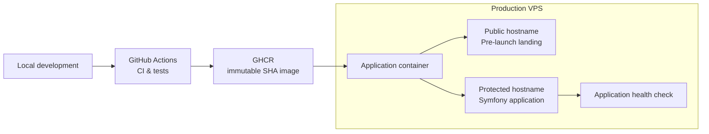

# Symfony App Template

Production-oriented Symfony application template based on
[dunglas/symfony-docker](https://github.com/dunglas/symfony-docker).

The template is designed around one idea:

**the production environment should be useful from the beginning of development, not introduced only when the application is ready to launch.**

A project created from this template can be deployed to its real VPS early,
developed and reviewed through the same production path that will later serve the
released application, while the unfinished application remains protected from
public access.

## Why This Template Exists

A common workflow is to develop an application locally first and design its
production deployment later.

This template takes the opposite approach.

The production path is established early:

```text
Local development → CI → immutable production image → production VPS
```

During development, the VPS can serve two different entry points:

* a public pre-launch page for visitors;
* the actual Symfony application on a separate hostname protected by Basic Auth.

This makes it possible to test the application in its real deployment
environment without exposing unfinished work publicly.

When the application is ready to launch, the public hostname can be moved from
the temporary landing page to the Symfony application without introducing a new
build or deployment model.

## Architecture



The same production image contains both the application and the pre-launch
landing page.

Caddy routes requests according to the configured hostnames.

## What Is Included

The template adds a focused application delivery workflow on top of
`dunglas/symfony-docker`:

* Symfony with FrankenPHP and Caddy;
* Docker Compose configurations for development and production;
* a static pre-launch landing page;
* production Basic Auth for the protected application hostname;
* a public application health endpoint;
* application CI and automated tests;
* a slim rootless production image;
* immutable production images published to GitHub Container Registry;
* full Git commit SHA as the production release identifier;
* opt-in production deployment;
* integration with a companion Ansible VPS template.

The intended production baseline is deliberately small.

The goal is not to provide every possible infrastructure component, but to
provide a production foundation that is understandable, reproducible, and
usable from the beginning of a project.

## Quick Start

Requirements:

* Docker;
* Docker Compose.

Create a repository from this template or clone it, then start the application:

```console
docker compose up -d --build --wait
```

Open:

```text
https://dev.localhost
https://landing.localhost
```

`dev.localhost` serves the Symfony application.

`landing.localhost` serves the pre-launch landing page.

Caddy generates the local TLS certificate automatically. Depending on your local
environment, the browser may require you to accept or trust that certificate.

Run the test suite:

```console
docker compose exec -T php bin/phpunit
```

Stop the application:

```console
docker compose down --remove-orphans
```

For a completely fresh rebuild:

```console
docker compose build --pull --no-cache
docker compose up -d --wait
```

A clean rebuild is useful when intentionally refreshing base images or
troubleshooting build state. It is not required for normal development.

## Local Development

The development configuration mounts the application source into the container,
so ordinary source changes do not require rebuilding the image.

The default local hostnames are configured in `.env`:

```dotenv
MAIN_SERVER_NAME=landing.localhost
SERVER_NAME=dev.localhost
```

The landing page is served from:

```text
infrastructure/landing/
```

Production Basic Auth is disabled by the local development override.

The local environment is intended for normal application development while
preserving the same basic routing model that will be used in production.

## Production Release Model

Every production release is identified by the full Git commit SHA.

For a push to `main`, GitHub Actions:

1. runs the application checks;
2. builds the production image;
3. publishes the image to GitHub Container Registry;
4. identifies the image with the full Git commit SHA;
5. optionally initiates deployment to the production VPS.

Production images follow this format:

```text
ghcr.io/<owner>/<repository>:<40-character-git-sha>
```

Mutable tags such as `latest` are not part of the deployment contract.

The production VPS does not clone this repository and does not build the
application from source.

It runs the image that was already tested, built, and published by CI.

## Production Deployment

Deployment is intentionally disabled by default.

A repository created from this template can run CI and publish production images
without being allowed to deploy them anywhere.

Production deployment becomes available only after the repository-level GitHub
Actions variable is explicitly configured:

```text
DEPLOY_ENABLED=true
```

Create it under:

```text
Settings → Secrets and variables → Actions → Variables
```

`DEPLOY_ENABLED` must be a repository-level Actions variable.

It must not be configured as a variable of the `production` GitHub Environment,
because the deployment job evaluates it before entering that environment.

The deployment path is:

```text
GitHub Actions → restricted SSH command → production VPS → requested SHA image → health validation
```

If the new release becomes healthy, deployment succeeds.

If deployment fails after the running release has already been modified, the
server-side deployment implementation restores the previous working release.

The detailed SSH configuration, GitHub Environment setup, runtime values, image
contract, and rollback behavior are documented in
[Production Deployment](docs/production.md).

## Application and Infrastructure Boundary

Server provisioning is deliberately outside this repository.

The companion
[Ansible VPS Template](https://github.com/lapkinu/ansible-vps-template)
provides the infrastructure side of the production deployment model.

This application repository is responsible for:

* application tests;
* production image build;
* GHCR publication;
* release identification;
* deployment initiation;
* the application health endpoint.

The infrastructure repository is responsible for:

* Debian VPS provisioning;
* administrator and deployment users;
* SSH hardening;
* Docker installation;
* firewall configuration;
* runtime secrets;
* GHCR authentication;
* the restricted deployment command;
* deployment serialization;
* health validation;
* rollback.

The primary values shared between the two repositories are:

```text
DEPLOY_APP                  ↔ deployment_app_name
DEPLOY_USER                 ↔ deployment_user
GHCR image repository       ↔ deployment_image_repository
MAIN_SERVER_NAME            ↔ deployment_main_server_name
SERVER_NAME                 ↔ deployment_server_name
DEPLOY_SSH_PRIVATE_KEY      ↔ deploy_ci_ssh_public_key pair
GET /health                 ↔ deployment_healthcheck_path
```

Keeping this interface explicit allows application delivery and server
provisioning to evolve independently.

## Pre-launch Mode

Production can expose two hostnames at the same time.

`MAIN_SERVER_NAME` serves the public pre-launch landing page.

`SERVER_NAME` serves the Symfony application and is protected by Basic Auth.

A typical configuration therefore looks like:

```text
example.com      → public pre-launch landing
dev.example.com  → Basic Auth → Symfony application
```

The landing page is served directly by Caddy and does not invoke Symfony.

It sends:

```text
X-Robots-Tag: noindex, nofollow
```

and includes a restrictive `robots.txt`.

These measures are intended to discourage indexing during the pre-launch phase.

At launch, the public application hostname can be moved to the Symfony
application without changing the production image format or deployment
protocol.

## Health Checks

The template uses two separate health mechanisms.

### Container health

The production container checks the internal FrankenPHP/Caddy runtime through
its metrics endpoint.

This verifies that the container-level web runtime is operational.

### Application health

The deployment system checks:

```text
GET /health
```

The endpoint must return HTTP `200` with:

```text
OK
```

The health route intentionally bypasses production Basic Auth.

It is part of the deployment interface between the application and the server
infrastructure.

Do not remove, rename, or protect this endpoint without updating the deployment
infrastructure accordingly.

## Production Configuration

Production secrets and runtime configuration are supplied outside the
application image.

Real production credentials must never be committed to the repository or baked
into the image.

The production configuration requires:

```text
APP_SECRET
BASIC_AUTH_USERNAME
BASIC_AUTH_PASSWORD_HASH
CADDY_MERCURE_JWT_SECRET
```

Missing required production values cause Docker Compose configuration to fail
before the application container is started.

Local development values and upstream development placeholders are not
production credentials.

Changing runtime configuration on the server does not automatically change the
environment of an already running container. The container must be recreated
through the deployment mechanism before new runtime values take effect.

For the complete production configuration contract, see
[Production Deployment](docs/production.md).

## Tested Production Baseline

The production workflow is designed and tested with:

* Debian 13;
* `amd64`;
* Docker Engine;
* Docker Compose;
* Symfony;
* FrankenPHP;
* Caddy;
* GitHub Actions;
* GitHub Container Registry.

Other operating systems, CPU architectures, registries, orchestrators, and cloud
providers may work, but they are outside the tested baseline of this template.

## Database Migrations

Database provisioning and migrations are not part of the current production
deployment contract.

The upstream Docker entrypoint contains optional Doctrine readiness and migration
support that becomes active when Doctrine is configured.

Projects adding a database should define their own production database,
migration, backup, and rollback strategy before relying on automatic migration
behavior.

## Documentation

Production deployment:

* [Production Deployment](docs/production.md)

Additional documentation inherited from `dunglas/symfony-docker`:

* [Configuration options](docs/options.md)
* [Extra services](docs/extra-services.md)
* [Xdebug](docs/xdebug.md)
* [TLS certificates](docs/tls.md)
* [MySQL](docs/mysql.md)
* [Troubleshooting](docs/troubleshooting.md)
* [AI coding agents](docs/agents.md)
* [Makefile integration](docs/makefile.md)

The inherited documentation describes optional capabilities and is not all part
of this template's tested production deployment baseline.

## Companion Infrastructure

The intended infrastructure repository is:

[Ansible VPS Template](https://github.com/lapkinu/ansible-vps-template)

Together, the two templates provide a complete path from application development
to a prepared VPS running an immutable production release.

The application repository produces the release.

The infrastructure repository prepares the server and controls how that release
is deployed.

## Upstream

This project is based on
[dunglas/symfony-docker](https://github.com/dunglas/symfony-docker), created by
Kévin Dunglas and contributors.

The upstream project provides the Symfony, Docker, FrankenPHP, Caddy, Mercure,
Vulcain, development tooling, and container foundation.

This template keeps that foundation and adds its own production workflow,
pre-launch routing, application health contract, immutable release model, and VPS
deployment integration.

## License

This project retains the MIT license included with the upstream Symfony project
skeleton.

See [LICENSE](LICENSE).
