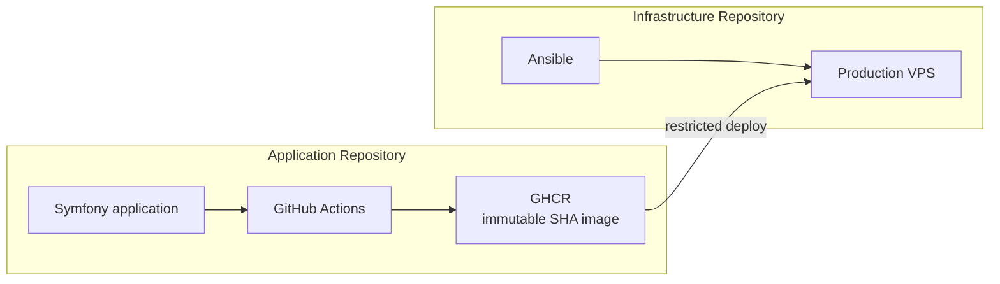
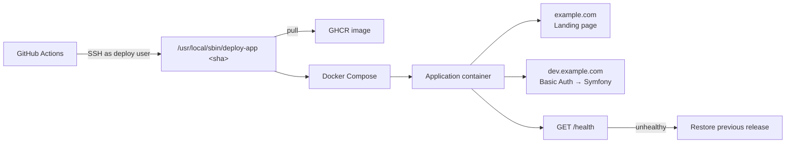

# Symfony App Template

Production-oriented Symfony application template based on
[dunglas/symfony-docker](https://github.com/dunglas/symfony-docker).

The template is designed around one idea:

**The production environment should be useful from the beginning of development, not introduced only when the application is ready to launch.**

A project created from this template can be deployed to its real VPS early, developed and reviewed through the same production path that will later serve the released application, while the unfinished application remains protected from public access.

---

## Companion Infrastructure

This repository builds, tests and publishes the immutable production image.

The companion [Ansible VPS Template](https://github.com/lapkinu/ansible-vps-template)  
prepares the server and controls how that image is allowed to run.

Together they provide a complete path from early development to a restricted production environment that can already be used while the application remains private.

---

## Why This Template Exists

A common approach is to develop locally first and design production deployment later.

This template reverses that order.

The production path is established early:

```text
Local development → CI → immutable production image → production VPS
```

During development the VPS can serve two entry points at the same time:

- a public pre-launch landing page
- the Symfony application on a separate hostname protected by Basic Auth

When the application is ready, the landing page and Basic Auth are disabled. The application becomes available on the main domain without introducing a new build or deployment model.

---

## Architecture

### Separation of responsibilities



The application repository produces the release.  
The infrastructure repository prepares the server and controls how the release is allowed to run.

### Deployment flow



In pre-launch mode the same container serves both the public landing page and the protected application.  
When the application is ready, the landing page and Basic Auth are disabled. The application becomes available on the main domain without changing the deployment model.

---

## What Is Included

The template adds a focused application delivery workflow on top of `dunglas/symfony-docker`:

- Symfony with FrankenPHP and Caddy
- Docker Compose configurations for development and production
- Static pre-launch landing page
- Production Basic Auth for the protected application hostname
- Public application health endpoint
- Application CI and automated tests
- Slim rootless production image
- Immutable production images published to GitHub Container Registry
- Full Git commit SHA as the production release identifier
- Opt-in production deployment
- Integration with the companion Ansible VPS template

The intended production baseline is deliberately small.  
The goal is a production foundation that is understandable, reproducible, and usable from the beginning of a project.

---

## Quick Start

Requirements:

- Docker
- Docker Compose

Create a repository from this template or clone it, then start the application:

```console
docker compose up -d --build --wait
```

Open:

```text
https://dev.localhost
https://landing.localhost
```

- `dev.localhost` serves the Symfony application
- `landing.localhost` serves the pre-launch landing page

Caddy generates the local TLS certificate automatically. Depending on your environment, the browser may require you to accept or trust that certificate.

Run the test suite:

```console
docker compose exec -T php bin/phpunit
```

Stop the application:

```console
docker compose down --remove-orphans
```

For a completely fresh rebuild:

```console
docker compose build --pull --no-cache
docker compose up -d --wait
```

The same image built by CI can later be deployed to a real VPS prepared by the companion [Ansible VPS Template](https://github.com/lapkinu/ansible-vps-template).

---

## Local Development

The development configuration mounts the application source into the container, so ordinary source changes do not require rebuilding the image.

Default local hostnames are configured in `.env`:

```dotenv
MAIN_SERVER_NAME=landing.localhost
SERVER_NAME=dev.localhost
```

The landing page is served from:

```text
infrastructure/landing/
```

Production Basic Auth is disabled by the local development override.

The local environment is intended for normal application development while preserving the same basic routing model that will be used in production.

---

## Production Release Model

Every production release is identified by the full Git commit SHA.

For a push to `main`, GitHub Actions:

1. runs the application checks
2. builds the production image
3. publishes the image to GitHub Container Registry
4. identifies the image with the full Git commit SHA
5. optionally initiates deployment to the production VPS

Production images follow this format:

```text
ghcr.io/<owner>/<repository>:<40-character-git-sha>
```

Mutable tags such as `latest` are not part of the deployment contract.

The production VPS does not clone this repository and does not build the application from source.  
It runs the image that was already tested, built and published by CI.

---

## Production Deployment

Deployment is disabled by default.

A repository created from this template can run CI and publish production images without being allowed to deploy them.

Production deployment becomes available only after the repository-level GitHub Actions variable is explicitly set:

```text
DEPLOY_ENABLED=true
```

Create it under:

```text
Settings → Secrets and variables → Actions → Variables
```

`DEPLOY_ENABLED` must be a repository-level Actions variable.  
It must not be configured as a variable of the `production` GitHub Environment.

The deployment path is:

```text
GitHub Actions → restricted SSH command → production VPS → requested SHA image → health validation
```

If the new release becomes healthy, deployment succeeds.  
If deployment fails after the running release has already been modified, the server-side implementation restores the previous working release.

Detailed SSH configuration, GitHub Environment setup, runtime values, image contract and rollback behaviour are documented in [Production Deployment](docs/production.md).

---

## Application and Infrastructure Boundary

Server provisioning is deliberately outside this repository.

The companion [Ansible VPS Template](https://github.com/lapkinu/ansible-vps-template) provides the infrastructure side of the production deployment model.

**This repository is responsible for:**

- application tests
- production image build
- GHCR publication
- release identification
- deployment initiation
- the application health endpoint

**The infrastructure repository is responsible for:**

- Debian VPS provisioning
- administrator and deployment users
- SSH hardening
- Docker installation
- firewall configuration
- runtime secrets
- GHCR authentication
- the restricted deployment command
- deployment serialization
- health validation
- rollback

The primary values shared between the two repositories are:

```text
DEPLOY_APP                  ↔ deployment_app_name
DEPLOY_USER                 ↔ deployment_user
GHCR image repository       ↔ deployment_image_repository
MAIN_SERVER_NAME            ↔ deployment_main_server_name
SERVER_NAME                 ↔ deployment_server_name
DEPLOY_SSH_PRIVATE_KEY      ↔ deploy_ci_ssh_public_key pair
GET /health                 ↔ deployment_healthcheck_path
```

Keeping this interface explicit allows application delivery and server provisioning to evolve independently.

---

## Pre-launch Mode

Production can expose two hostnames at the same time.

- `MAIN_SERVER_NAME` serves the public pre-launch landing page
- `SERVER_NAME` serves the Symfony application and is protected by Basic Auth

A typical configuration:

```text
example.com      → public pre-launch landing
dev.example.com  → Basic Auth → Symfony application
```

The landing page is served directly by Caddy and does not invoke Symfony.  
It sends `X-Robots-Tag: noindex, nofollow` and includes a restrictive `robots.txt`.

At launch, the landing page and Basic Auth are disabled on the infrastructure side.  
After applying the configuration change, re-run the **Deploy production** job in this repository so the running release picks up the new settings.  
No new image or change to the deployment protocol is required.

---

## Health Checks

The template uses two separate health mechanisms.

### Container health

The production container checks the internal FrankenPHP/Caddy runtime through its metrics endpoint.  
This verifies that the container-level web runtime is operational.

### Application health

The deployment system checks:

```text
GET /health
```

The endpoint must return HTTP `200` with:

```text
OK
```

The health route intentionally bypasses production Basic Auth.  
It is part of the deployment interface between the application and the server infrastructure.

Do not remove, rename or protect this endpoint without updating the deployment infrastructure accordingly.

---

## Production Configuration

Production secrets and runtime configuration are supplied outside the application image.

Real production credentials must never be committed to the repository or baked into the image.

Required production values:

```text
APP_SECRET
BASIC_AUTH_USERNAME
BASIC_AUTH_PASSWORD_HASH
CADDY_MERCURE_JWT_SECRET
```

Missing required values cause Docker Compose configuration to fail before the application container is started.

Changing runtime configuration on the server does not automatically change the environment of an already running container.  
The container must be recreated through the deployment mechanism before new values take effect.

For the complete production configuration contract, see [Production Deployment](docs/production.md).

---

## Tested Production Baseline

The production workflow is designed and tested with:

- Debian 13
- `amd64`
- Docker Engine
- Docker Compose
- Symfony
- FrankenPHP
- Caddy
- GitHub Actions
- GitHub Container Registry

Other operating systems, CPU architectures, registries, orchestrators and cloud providers may work, but they are outside the tested baseline of this template.

---

## Database Migrations

Database provisioning and migrations are not part of the current production deployment contract.

The upstream Docker entrypoint contains optional Doctrine readiness and migration support that becomes active when Doctrine is configured.

Projects adding a database should define their own production database, migration, backup and rollback strategy before relying on automatic migration behaviour.

---

## Documentation

Production deployment:

- [Production Deployment](docs/production.md)

Additional documentation inherited from `dunglas/symfony-docker`:

- [Configuration options](docs/options.md)
- [Extra services](docs/extra-services.md)
- [Xdebug](docs/xdebug.md)
- [TLS certificates](docs/tls.md)
- [MySQL](docs/mysql.md)
- [Troubleshooting](docs/troubleshooting.md)
- [AI coding agents](docs/agents.md)
- [Makefile integration](docs/makefile.md)

The inherited documentation describes optional capabilities and is not all part of this template’s tested production deployment baseline.

---

## Upstream

This project is based on [dunglas/symfony-docker](https://github.com/dunglas/symfony-docker), created by Kévin Dunglas and contributors.

The upstream project provides the Symfony, Docker, FrankenPHP, Caddy, Mercure, Vulcain, development tooling and container foundation.

This template keeps that foundation and adds its own production workflow, pre-launch routing, application health contract, immutable release model and VPS deployment integration.

---

## License

This project retains the MIT license included with the upstream Symfony project skeleton.

See [LICENSE](LICENSE).
